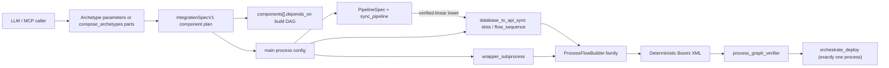

# M12 architecture audit at the 2026-07-12 baseline

> Moved verbatim on 2026-11-26 from the description of issue #134 (the M12 epic), where it stood under "Historical record — architecture audit at the 2026-07-12 baseline". It is a historical record: it describes branch `dev` at commit `6665c555b076bf7967e02b322c96311992cec14f`, and the roadmap on #134 controls wherever the two differ. The text below is unchanged. Its phrase "the 2026-08-11 parity audit above" refers to the 2026-08-11 addendum in the description of #134.

## Architecture verdict

Select **Option E: a typed structured AST plus a compiler-owned internal graph**, implemented by promoting the shipped `flow_sequence` semantics into a strict, versioned `ProcessIRV1` facade. This is not a permanent fourth DSL: all existing runtime representations became transitional adapters, new capabilities enter only through `ProcessIRV1`, and the legacy inputs are deleted at #160 once every working capability has transferred (#149–#159).

Keep `IntegrationSpecV1` as the **component materialization plan/compiler output**, not the runtime process graph. Treat `PipelineSpec` as a transitional analysis view (deleted with the legacy shell). Add a separate, capability-gated `SystemTopologySpecV1` for relationships that do not belong in one process graph.

## Current-state architecture (at the 2026-07-12 baseline)

## Representation inventory

| Representation | Purpose / owner | Public? | Typed? | Executable? | Lowering / verification | Main limitation |
|---|---|---:|---|---:|---|---|
| `IntegrationSpecV1.components` | Component create/update/reuse plan | Yes | Envelope typed; `config` free-form | Yes | Topological component build | Not runtime document flow |
| `components[].depends_on` | Materialization and reference order | Yes | List of keys | Yes | `integration_builder` topo-sort | Cannot express process control flow |
| `IntegrationSpecV1.pipeline` | Inspectable semantic copy | Yes | `PipelineSpec` | No, inert alone | None | Duplicates executable process config |
| `process.config.pipeline` | `sync_pipeline` input | Yes | Typed graph shell; free-form stage config | Narrowly | Linear lower to legacy slots | No nonlinear lowering or generic connector step |
| `source/transform/target` plus blocks | Original DB-to-API builder contract | Yes | Dictionary validated by hand | Yes | Monolithic `ProcessFlowBuilder` | Source/target-centric, single slots |
| `flow_sequence` | Ordered multi-shape executable flow | Yes | Strict key allowlists, dictionary nodes | Yes | Existing deterministic emitters | DB source, REST target, terminal controls, no generic connector call |
| `wrapper_subprocess.process_calls` | Facade parent macro | Yes | Dictionary entries | Yes | Separate builder | Only start -> calls -> stop/return |
| `compose_archetypes` parts/links | DB -> map -> REST fan-out recipe | Yes | Typed envelope with dictionary payloads | Yes | Rewrites to `flow_sequence` | Fixed star topology only |
| Primitive `emit_fragment` | Builder/archetype contribution | Internal | Explicitly free-form | Sometimes | Convention-based merge | Parallel contract and drift risk |
| Cache/property models + lineage walker | DDP/DPP/cache semantics | Internal/public schema | Strongly typed vocabulary | Only on current config | Pre-mutation lineage checks | Not attached to `PipelineSpec` |
| `process_graph_verifier` | Emitted/live XML integrity | Internal surface | XML graph | Verification only | Post-emission/live GET | Cannot recover semantic intent |
| Doctrine/gotchas/governance | Advisory design knowledge | Public KB | Curated records | No | Planner selection | Must not become executable prose |
| `plan_integration_design` | Deterministic doctrine brief | Public | Static response | No | No Boomi call | Not a typed integration design model |

Grounding: `integration_models.py:12-97`, `pipeline_models.py:69-313`, `process_flow_builder.py:242-321, 4642-5756, 6505-7510`, `integration_builder.py:867-897, 5820-5975`, `patterns/composition.py:1-37, 378-607, 829-1107`.

## Capability matrix (as measured at the 2026-07-12 baseline; the 2026-08-11 parity audit above supersedes it as the gap census)

Legend: **yes** = current path exists; **partial** = narrower than the requested semantics; **no** = absent. “Recorded QA” means a closed issue records live QA; this architecture task did not rerun mutating QA.

| Capability | Represented | Pre-mutation validated | Emitted | Graph-verified | Live-QA status | Current surface / blocker |
|---|---:|---:|---:|---:|---|---|
| DB read | yes | yes | yes | yes | recorded #30/#75 | preset or linear pipeline |
| DB write | yes | yes | yes | yes | recorded #75 | linear pipeline target |
| REST fetch/send | yes | yes | yes | yes | recorded #75 | linear pipeline / fixed target |
| SOAP fetch/send | yes | yes | yes | yes | recorded #126 | linear pipeline slots only |
| Map direct/function/script | yes | yes | yes | reference only | recorded M2/M11 | map subsystem is not the main bottleneck |
| Process-level script/Data Process | partial | partial | yes | yes | recorded #106/#117 | `flow_sequence.dataprocess`; limited variants |
| Branch | yes | yes | yes | yes | recorded #112/#117/#125 | ordered terminal fan-out |
| Decision | yes | yes | yes | yes | recorded #113/#117 | binary; composed forward chaining absent |
| Nested Branch/Decision | partial | partial | partial | yes | recorded #117 | decision may end in Branch; Branch legs linear |
| Connector call inside Branch | partial | partial | partial | yes | narrow M8 QA | one terminal REST target per leg |
| Connector call inside Decision | partial | partial | partial | yes | narrow #117 QA | top REST target or nested Branch only |
| Multiple connector calls per path | no | no | no | no | none | no `connector_call` node |
| Try/Catch | yes | yes | yes | yes | recorded #51/#88/#99 | cannot wrap `flow_sequence` |
| Per-connector retry | partial | partial | yes | yes | recorded reliability QA | legacy source/target shell |
| DLQ | yes | yes | yes | yes | recorded #51/#87 | cache or error subprocess catch path |
| Subprocess | yes | yes | yes | yes | recorded #90 | separate wrapper DSL |
| Return Documents | yes | yes | yes | yes | recorded #107 | terminal, restricted placement |
| DDP | yes | yes | yes | structural only | recorded #121/#125 | `flow_sequence` lineage |
| DPP / Process Property | yes | yes | yes | structural only | recorded #121/#131/#125 | current config + map functions |
| Document Cache put/get/join | partial | yes | yes | structural only | recorded #122/#125/#132 | all-document path; keyed modes gated |
| Process join/merge | no | no | no | no | none | explicit named gate required |
| Listener | yes in checkout | yes | yes | yes | recorded #12/#133 | linear WSS source; live MCP registry is behind checkout |
| Queue/Event Streams topology | guidance only | no | no | no | none; work has 0 queues | topology representation may model; mutation remains gated |
| Schedule | external tool | action-level | external API | n/a | existing orchestration QA | not part of an integration design/topology model |
| Async multi-process topology | guidance only | no | no | no | none | no typed topology compiler |
| Deployment relationships | partial | partial | special cases | n/a | existing orchestration QA | materialization DAG plus one-process deploy target |

## Target-use-case failure walkthrough (baseline motivation)

The requested API/listener -> validate/map -> Branch design fails at the first general mixed leg:

1. `PipelineSpec` can name Branch/Decision and typed edges, but `SyncPipelineBuilder` rejects every non-ordering edge and accepts only one source, optional map, and one target.
2. `flow_sequence` can emit maps, data processing, properties, cache, Branch, and Decision, but it is anchored to a DB source and top-level REST target.
3. A Branch leg is a linear non-connector prefix plus one terminal REST target. It cannot execute REST fetch -> Map -> SOAP -> DB -> REST, nor repeat connector calls.
4. A Decision body cannot contain arbitrary connector calls. Control nodes terminalize their sequence; no general continuation or join exists.
5. Try/Catch and dynamic-path blocks are rejected beside `flow_sequence`.
6. `wrapper_subprocess` and `compose_archetypes` add more executable macros rather than a common runtime model.
7. A later queue consumer, scheduled recovery process, listener/ASC, shared cache, and deployment relationships exceed any single process graph; current `orchestrate_deploy` requires exactly one process component.

## Options considered

| Option | Decision | Rationale |
|---|---|---|
| A — Complete PipelineSpec | Reject as public canonical authoring | Useful edges, but free-form stage payloads, shallow semantics, an inert duplicate, and almost no nonlinear lowering. Reuse its edge ideas in the internal CFG/adapter. |
| B — Generalize flow_sequence | Use as the migration seed, not as-is | It is the strongest executable precursor. Promote it into typed discriminated models and remove source/target coupling through the compiler. |
| C — Greenfield ProcessIRV1 | Reject if parallel | It would be the prohibited fourth DSL. Accept only as the renamed/typed consolidation target that absorbs `flow_sequence` and adapters. |
| D — Typed arbitrary graph | Reject for LLM authoring | Exposes connectivity and low-level failure modes; makes semantic validation and reliable model generation harder. |
| E — Structured AST + internal CFG | **Select** | The LLM owns typed intent and nesting; the compiler owns connectivity, IDs, layout, and XML. It matches the repository’s deterministic-builder direction. |

## Target architecture

```mermaid
flowchart LR
  I["IntegrationDesignV1 (conceptual planning intent — advisory, non-executable)"]
  T["SystemTopologySpecV1 (typed, capability-gated, planning-only)"]
  S["IntegrationSpecV1 (component/materialization plan)"]
  R["ProcessIRV1 per authored process (strict structured AST)"]
  SV["Pre-CFG structural validation"]
  G["Compiler-derived semantic CFG (no layout)"]
  V["CFG-aware semantic validation (#143)"]
  EP["Deterministic emission plan (synthetic shapes, IDs, dragpoints, layout, wiring)"]
  E["Verified emitters"]
  X["Boomi XML"]
  Q["post-emission graph verify + live QA"]

  I -.->|advisory| T
  T -.->|"advises planning; never feeds the process compiler"| S
  S -->|"per-process semantic payload (adapters/recipes or direct #146 authoring)"| R
  R --> SV --> G --> V --> EP --> E --> X --> Q
  S -->|"materialization DAG; compiler-produced ComponentPlan is the boundary"| E
```

Layer responsibilities:

1. `IntegrationDesignV1`: trigger, systems, operations, contracts, sync/async, ordering, throughput, idempotency, error/state/deployment assumptions. **Conceptual/advisory only** (ADR-001 §4 "Advisory text"): it is planning intent, not XML input, and not a versioned M12 deliverable — no child issue defines or implements an `IntegrationDesignV1` model, and #146's `plan_integration_design` stays an advisory brief. Promoting it to a typed model would require its own issue under ADR-001 §9.
2. `SystemTopologySpecV1`: processes, listeners, schedules, queues, shared resources, deployment units, typed links, and capability status. Planning-only: it advises planning and never feeds the process compiler (ADR-001 §3). Unverified queue/Event Streams mutation remains gated.
3. `ProcessIRV1`: strict discriminated structured nodes promoted from `flow_sequence`: Sequence, ConnectorCall, MapRef, Branch, Decision, TryCatch, property/cache operations, ProcessCall, ReturnDocuments, Stop, and Throw. No XML, IDs, or dragpoints.
4. Semantic validation is two-phase (ADR-001 §3): local/structural checks — model/reference/type, profiles, capability gates — run at the AST before the CFG exists; the graph-aware checks — reachability, cardinality across ordered legs, state/document lineage, side-effect ordering, retry/idempotency safety, terminals — are #143's unified pass, run after the compiler derives the CFG and before the emission plan.
5. Internal semantic CFG: derived only; owns typed edges (control meaning), edge ordering, loop classification, and reachability — no XML or layout state. The separate deterministic emission plan (#137) owns synthetic shapes, stable Boomi IDs, dragpoints, layout, and wiring.
6. `IntegrationSpecV1`: remains the component/materialization plan; the compiler-produced ComponentPlan (the emitted component plus its wiring) is the boundary between each per-process root and that plan (ADR-001 §3). No `IntegrationSpecV2` is required for M12.
7. Verified emitters: deterministic, evidence-backed, byte-locked.
8. Presets/recipes: typed translators into IR/topology/component contributions; doctrine remains advisory.

The endgame extends this chain per the roadmap's end state: #153 adds `ProcessComponentEnvelopeV1`/`ProcessAuthoringUnitV1`, the neutral `ProcessComponentMaterializer`, and the two-level attestation (relocatable plan fingerprint pre-apply; submitted-XML digest + live-readback digest at apply).

## Migration posture (replaces the struck "Backward compatibility and migration" section)

- Current schema, error, and golden behavior were frozen before routing (#135); goldens are raw-byte anchors.
- Adapters for `database_to_api_sync`, `sync_pipeline/PipelineSpec`, `flow_sequence`, `wrapper_subprocess`, and `compose_archetypes` were TRANSITIONAL parity oracles, never a compatibility surface: with zero external consumers there is no deprecation window and no adapter-parity obligation. #159 migrates every author to ProcessIR roots; #160 deletes the adapters once callerless.
- `IntegrationSpecV1.pipeline` is not another source of truth; drift against the executable process surfaces as an error until the dual surface is deleted (#160).
- Compatibility exemptions in lineage/validators live inside adapters, never the new IR, and die with the adapters.
- Capability-gated errors precede exposing new constructs as emittable.

## Reused completed work

Reuse, do not duplicate: #69/#104 (typed stages/edges), #70/#71/#127/#128 (linear lowering/parity), #117 (sequencer), #112/#113/#116 (control flow), #118/#120-#123/#131 (state and lineage), #14/#132 (composition/cache handoff), #90 (subprocess), #12/#133 (listener/ASC), #80/#130 (structural verifier), #86/#94 (advisory/planner), and #32/#72/#126 (typed connector families).

At audit time no issue owned `ProcessIRV1`, `SystemTopologySpecV1`, or canonical compiler consolidation; they are now owned and shipped by #135–#146.

## Risk register (mitigations as adopted)

| Risk | Mitigation |
|---|---|
| New IR becomes a fourth DSL | Promote from `flow_sequence`; transitional adapters first (deleted at #160); prohibit new capability on legacy forms. |
| Golden output drift during extraction | Byte-for-byte parity gates per process dialect before feature work; survivor goldens raw-byte anchored. |
| Monolithic builder refactor causes regressions | Separate internal CFG and emitter-registry issues; keep verifier as acceptance oracle. |
| LLM schema becomes too complex | Structured nesting, discriminated nodes, strict unknown-field rejection, capability query. |
| Semantic validator false positives around scripts/maps | Make opaque effects explicit (#154's typed effect contracts); legacy exemptions only in adapters. |
| Join/continuation semantics are guessed | Keep named gates until official/live evidence and focused issue approval. |
| Queue/topology support is overclaimed | Model intent with capability status; work-profile queue count is zero, so mutation remains gated. |
| Deployment cannot apply multiple processes atomically | Topology scope is plan/validation first; multi-process mutation is a later evidence-backed slice. |
| Live capability surface drifts from checkout | Schema/capability parity tests and deployment-version evidence; #147 owns the closeout drift check. |
| Secret leakage through flexible nodes | Component references only; recursively scan/redact configs; no connection credentials in IR. |

## Evidence and open questions

Read-only live `work` evidence found 85 processes, 100 Document Cache components, 81 Process Property components, six inactive schedules, two environments, zero queues, and zero active deployments. Representative live XML showed process calls, ordered Branch cache maintenance, Decision + DDP/cache/script/Exception, connector + Try/Catch + Return Documents.

Official KB retrieval confirms Branch paths execute sequentially to completion and Document Cache supports cross-branch/process-scope handoff. KB coverage for DDP sibling visibility and several continuation/Decision details was low confidence; keep repo/live fixtures as evidence and do not overclaim.

Open questions (unresolved items stay gated; #147 verifies the served capability surface is honest about them at closeout):

- What exact continuation model is valid after ordered Branch paths without inventing a join?
- Which bounded loop forms should be LLM-facing?
- What live evidence will unlock keyed cache operations and queue/Event Streams mutation?
- How should a topology plan express multi-process rollout, rollback, and partial deployment?
- How should connector operation refs expose trustworthy input/output profile contracts for adjacency validation?
- When should the deployed MCP service be upgraded? It listed four archetypes while this checkout registers six (#147 owns the drift check and remediation record).
